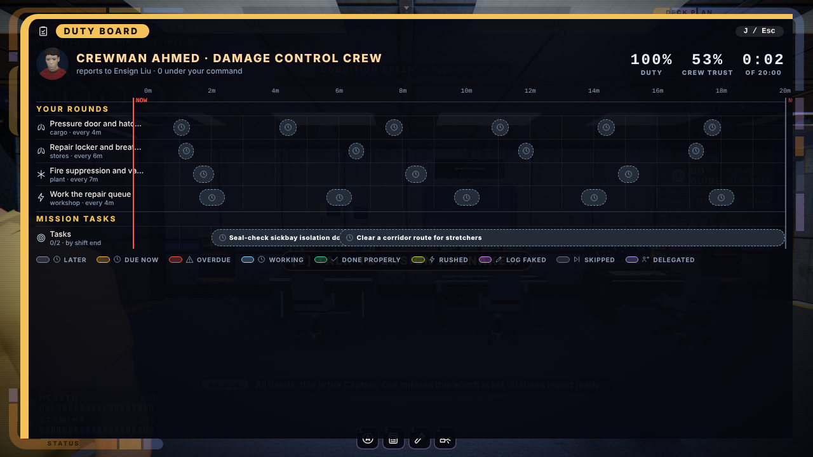
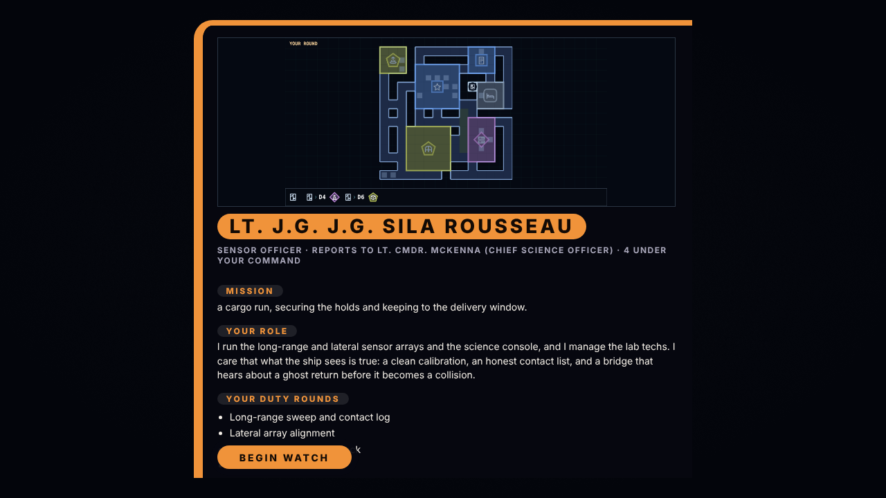
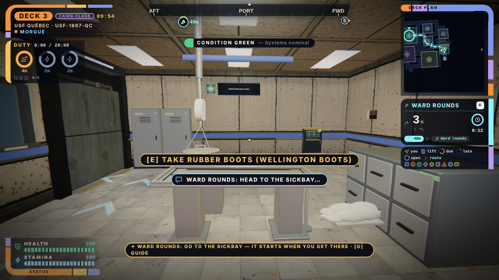
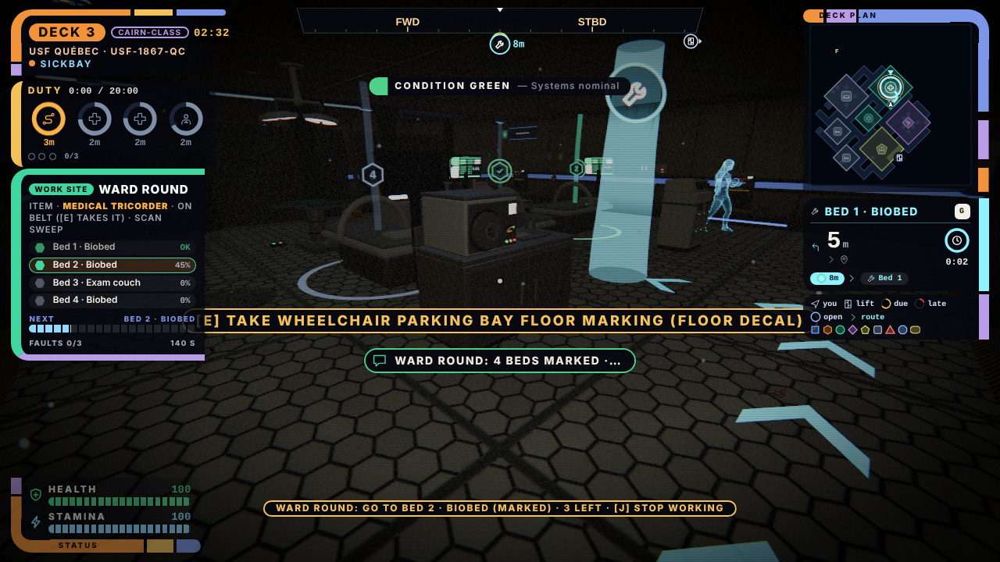
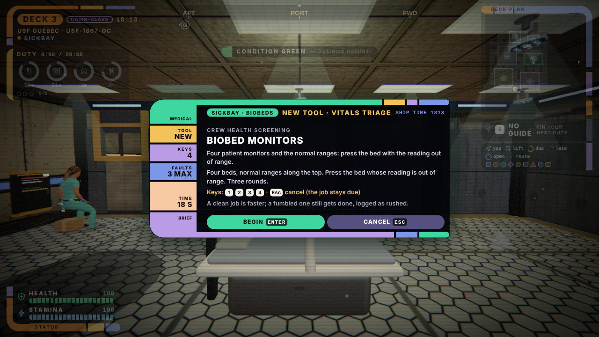
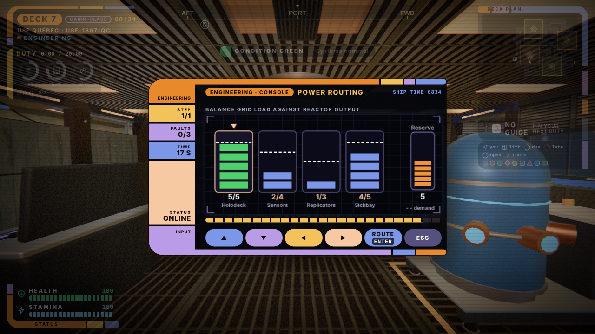
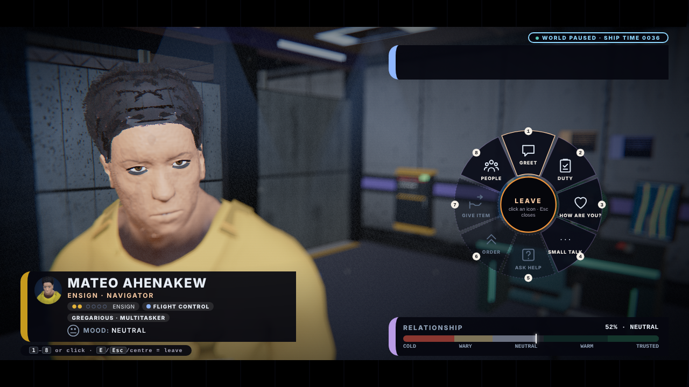
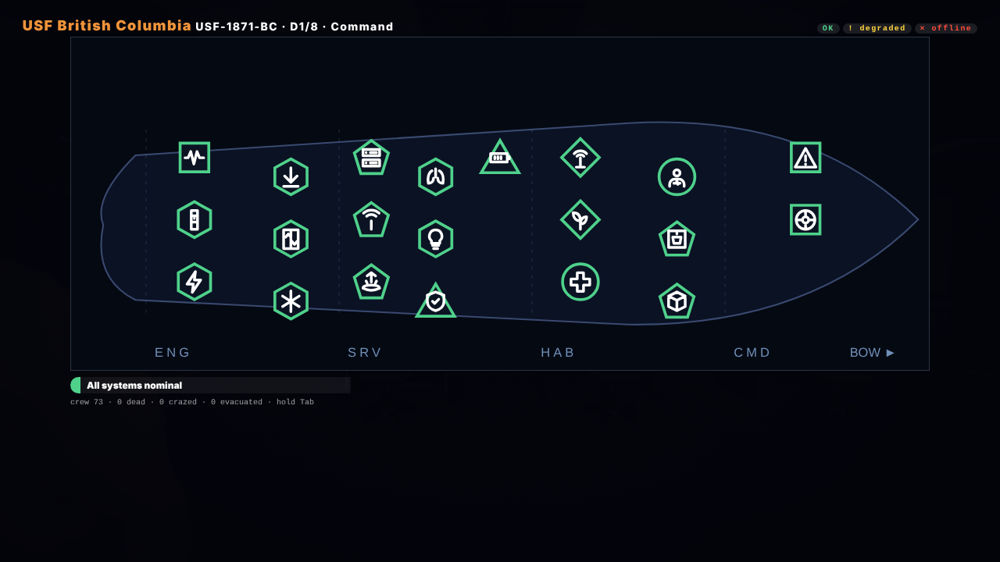
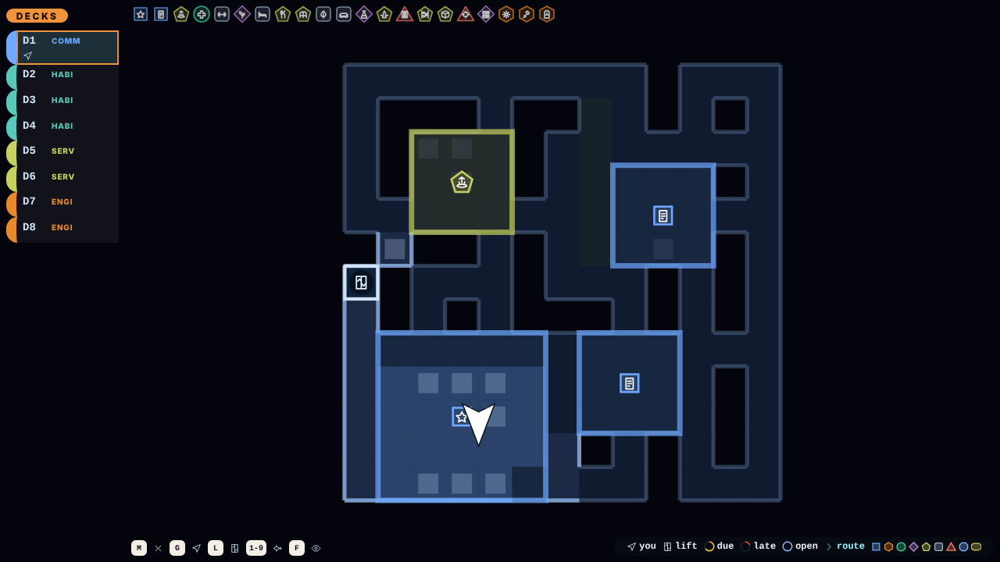

# Starfarers: The Backdecks — Systems Nominal

A first-person ship-life sim built with three.js. You are dealt a random billet aboard a fully working
United Starfarers' Fleet ship — from Captain down to Cargo Handler — and you can do that person's job, cut
corners, or ignore it. The ship, and the 60–90 named crew aboard it, answer back. (A parody/homage; see [CREDITS.md](CREDITS.md).)

> **Status:** Systems Nominal is the default mode and the focus of development. Everything below describes it.

## The idea

At the start of a watch the game picks a ship, a mission, and one crew member to be **you**. You get their name,
rank, uniform, superior, subordinates and duty card. The ship is running normally; every duty you do properly,
rush, fake or skip feeds a ledger that moves system health, crew trust and what your superior thinks of you.
Nothing is scripted to fail: a ship whose duties are done stays nominal for a long time.

## What you can do

**Walk a living ship.** Ten ships (named for Canadian provinces) in five hull classes, 8–9 decks each, with
bridges, engineering, sickbay, galley, cargo, arboretum and hundreds of fixtures. The crew follow schedules:
they walk between stations, ride the tubelifts, eat, work and gather in groups.

**Do your job.** Your *duty rounds* come due at stations around the ship; mission tasks must be finished by the
end of the shift. Do each one **properly** (slower, no debt) or **rushed** (faster, quietly adds duty debt).
Press **J** for the duty board and pick **Properly** on any job: if you are already there it starts, otherwise
the route is pinned (minimap ribbon, floor chevrons, compass, lift panel) and the job opens by itself when you
arrive.

**Work with your hands.** Physical jobs happen in the room. A ward round marks the beds in order and you scan
each patient with the medical tricorder, sweeping until the reading peaks. A medication round has you charge the
hypospray at each bed and let go inside the dose band. You mop the grime patches in the galley, wipe down the
surgical bay, tap stock into the dispensers, feed and harvest the grow beds, ratchet cargo straps to tension,
tally crate stacks on a PADD, swab sample points in the lab, inspect hardware with the engineering tricorder,
torque fittings on a repair round, and walk patrols, hatch rounds and shuttle walk-rounds with a lamp. Each job
needs the right item in your hand: if it's on your belt the first **E** takes it out, and if you don't carry one
the room's supply point is marked first. Every site gets a glowing ring, a beam and a numbered tag with a
progress ring, the next one is pinned, and an LCARS checklist on the left shows the sites, the item and a meter
for the current action.

**Learn the consoles.** Desk and console work plays a short mini-game about *that* job, in the ship's own
console style (elbow frame, station pill and ship time, a rail of status blocks, a segmented timer), and the first
time you meet each tool an instruction card in the same frame tells you how it works. Sickbay reads patient
monitors, counts controlled meds and runs counselling sessions; engineering routes power and bench-tests parts;
science sweeps for a signal and classifies contacts; security checks badges; the galley works the range; cargo
matches crate codes and keeps the deck in trim; the helm plots courses, keeps station against a current, flies
braking burns and takes star fixes; the transporter dials drifting beam coordinates. Paperwork is never the same
code twice: report forms filled from the readings, roster posts, priority queues, schedule slots, backup verify,
PA announcements, log trend reviews and log sign-off, each themed by the job (an engineering status report reads
core temperature and EPS load; a medical one, beds and hypo stock). Reports to a person are spoken briefs (turn
to them, most urgent first, catch the wrong figure in their read-back); command calls weigh options against two
limits; the helm flies survey grids, best-speed runs, hard turns and orbit holds on heading and throttle; guard
posts watch the door for tailgaters and unsigned transfer orders; the labs set, run and read instrument traces;
sickbay sorts casualties red / yellow / green and re-tags them as they change; standby jobs wait quietly for the
one call that needs a fast, right answer.

Physical jobs happen in the room with the real tool: crank valves with a spanner by turning your view, reset
tripped breakers panel by panel, weld hull seams with the plasma torch, sweep the flight deck with a push broom,
fuel the shuttles, charge cells at the rack, sweep force-field emitters with the security tricorder, dog hatches,
carry trays, crates and sample cases from a trolley to each drop point, walk the gauges calling each one in or
out of limits, count stock onto the shelves, screen and examine crew with the medical tricorder, splint, crimp
hazmat seals, zero sights at the range. Every job in the ship was audited twice (docs/job-audit.md):

| | before | now |
|---|---|---|
| distinct activities (console games + work sites) | 38 | 101 |
| jobs done hands-on in the room | 147 | 317 of 701 |
| largest single activity | console code, 11.7 % | verbal brief, 5.6 % |
| largest share inside one department | console code, 50 % of command | verbal brief, 15 % of command |

Each round is seeded, and two jobs of the same kind get different content (theme, props, tool, band) from their
label. A clean job is faster; a fumbled one still gets done and is logged as rushed. Rushing is
always one key and never a game. Esc (or **J → Stop working**) cancels, and the job stays due. Everything is
keyboard-driven and honours calm visuals, sound captions and the colour-blind palette.

| Choosing a job from J pins the route | Work sites: the ward round |
|---|---|
|  |  |

| First-use instructions | A console mini-game |
|---|---|
|  |  |

**Talk to people.** Press **E** on a crew member and the camera moves in for a close-up conversation while the
world pauses. Greet, ask about duty, small talk, ask for help, give orders (rank permitting), swap items, ask
who they hang out with. Trust shifts with what you say and what you've done.

**Keep the ship running.** Departments' systems (reactor, life support, gravity, comms, hydroponics…) can degrade
and cascade into each other. **Tab** shows the ship's status; faults show on the HUD and map, and a pacing
director decides when things go wrong and when you get a breather.

**Find your way.** A deck plan sits in the corner, a compass runs along the top, and **M** opens the full map with
every deck, room type and lift. **G** pins a destination and draws floor chevrons to it; the lift panel marks the
pinned deck.

**Fix, carry, push and fight (a little).** Hold **E** to repair junctions and hardware. Pick up tools, trays and
boxes, push carts, climb onto catwalks and service ladders. Handhelds (tricorders, phasers on stun, medical and
engineering tools) double as improvised weapons, and fights are grappling and melee, not gunplay.

## Play

Serve the folder statically (ES modules need http):

    python3 -m http.server 8000   # then open http://localhost:8000

No build step; three.js and its addons are vendored in `vendor/`. Models, textures and the HDRI are in `assets/`.
The first load shows a loading screen that preloads every crew portrait; press **Enter the ship** when it's ready.
On the title screen pick a shift length: **First watch** (~50 min, guided first task), **Standard** (~20 min) or
**Crunch** (~14 min).

## Controls

| | |
|---|---|
| **W A S D** | move |
| **Shift** | sprint (loud) |
| **Space** | jump / climb props / wall-jump |
| **C** | creep, or slide while sprinting |
| **Mouse** | look |
| **E** | interact · talk · hold to repair |
| **J** | duty board (hold: duty wheel) |
| **Tab** (hold) | ship status |
| **M** | map |
| **G** | pin the next duty / cycle pins |
| **Q** (hold) | quick wheel |
| **H** | radio (hold: radio wheel) |
| **V** · **1–9** | tools · belt |
| **K** · **L** | alerts · comm log |
| **F** | flashlight |
| **P** · **Esc** | pause · close the top menu layer |

The pause menu has **Calm visuals**, **Sound captions** and a **Colour-blind palette**.

## Reference pages

Open these from the same server:

- `crew.html` — chain of command, department loadouts; break and repair any system and see its effects.
- `ships.html` — fleet schematics (profile and deck plans for all ten ships).
- `social.html` — the social tracker: groups, friendships, rivalries.
- `models.html` — model viewer (`?set=crew|enemies|misc|props|moves|styles`, `?clip=<name>`).
- `voices.html` — crew voice sampler.

Design notes live in `docs/` — start with `docs/DESIGN-systems-nominal.md`; open work and handoff notes are in `TODO.md`.

## Tests

`node tools/test.mjs` runs the headless suite (needs Playwright + Chromium; it starts its own static server) and
prints `OK` or `FAIL <check>` lines, each with a `replay:` command. `--gate` runs the fast node-only sections plus a
browser smoke test (under 2 minutes); `--only a,b --seed N` replays specific sections. Details are in `TODO.md`.

## Credits

Third-party CC0 characters, animation, props, textures and HDRI, with thanks: **MakeHuman**, **dramatis3d**
(Tonio Loewald), **Quaternius**, **Poly Haven**, **ambientCG**. Full list and licenses in [CREDITS.md](CREDITS.md).
