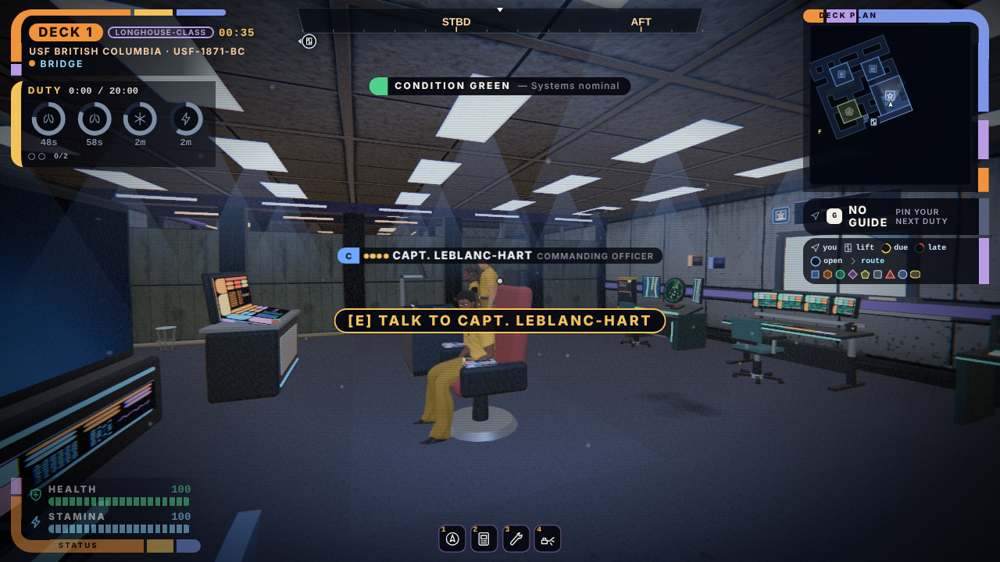
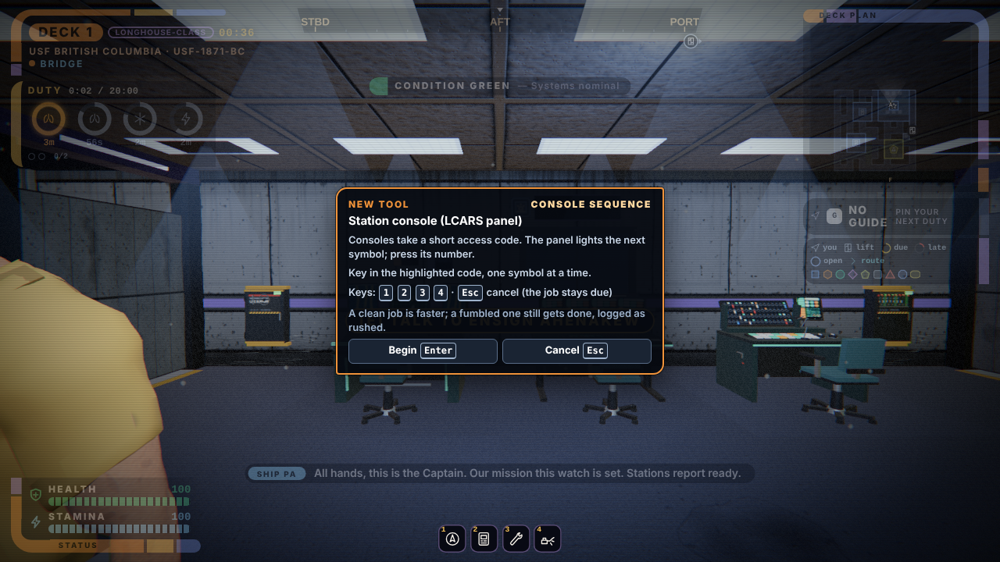
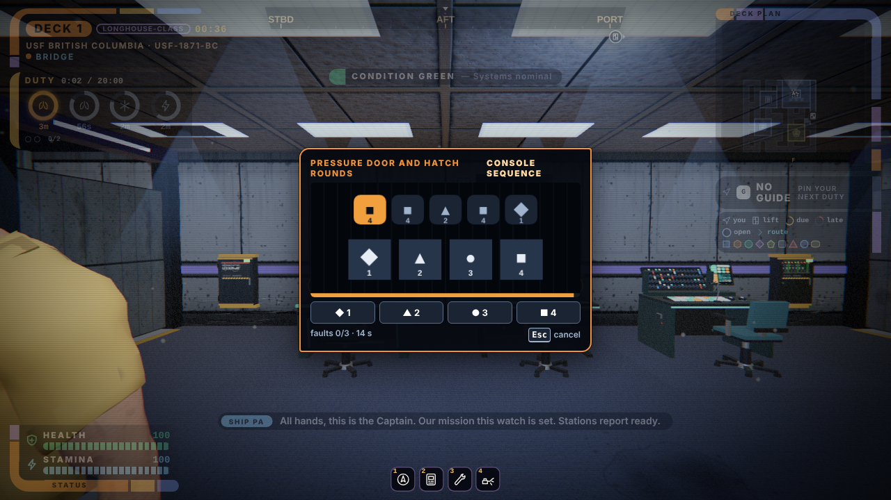

# Starfarers: The Backdecks — Systems Nominal

A first-person ship-life sim built with three.js. You are dealt a random billet aboard a fully working
United Starfarers' Fleet ship — from Captain down to Cargo Handler — and you can do that person's job, cut
corners, or ignore it. The ship, and the 60–90 named crew aboard it, answer back. (A parody/homage; see [CREDITS.md](CREDITS.md).)

> **Status:** Systems Nominal is the default mode and the focus of development. Everything below describes it.

## The idea

At the start of a watch the game picks a ship, a mission, and one crew member to be **you**. You get their name,
rank, uniform, superior, subordinates and duty card. The ship is running normally; every duty you do properly,
rush, fake or skip feeds a ledger that moves system health, crew trust and what your superior thinks of you.
Nothing is scripted to fail: a ship whose duties are done stays nominal for a long time.

## What you can do

**Walk a living ship.** Ten ships (named for Canadian provinces) in five hull classes, 8–9 decks each, with
bridges, engineering, sickbay, galley, cargo, arboretum and hundreds of fixtures. The crew follow schedules:
they walk between stations, ride the tubelifts, eat, work and gather in groups.

**Do your job.** Your *duty rounds* come due at stations around the ship; mission tasks must be finished by the
end of the shift. Do each one **properly** (slower, no debt) or **rushed** (faster, quietly adds duty debt).
Press **J** for the duty board.

**Learn the tools.** The first time you use a station console, tool or panel, an instruction card tells you how it
works, then a short mini-game ties into the job. A clean run is faster; a fumbled one still gets done and is
logged as rushed. Esc always cancels, and the job stays due.

| First-use instructions | The mini-game |
|---|---|
|  |  |

**Talk to people.** Press **E** on a crew member and the camera moves in for a close-up conversation while the
world pauses. Greet, ask about duty, small talk, ask for help, give orders (rank permitting), swap items, ask
who they hang out with. Trust shifts with what you say and what you've done.

**Keep the ship running.** Departments' systems (reactor, life support, gravity, comms, hydroponics…) can degrade
and cascade into each other. **Tab** shows the ship's status; faults show on the HUD and map, and a pacing
director decides when things go wrong and when you get a breather.

**Find your way.** A deck plan sits in the corner, a compass runs along the top, and **M** opens the full map with
every deck, room type and lift. **G** pins a destination and draws floor chevrons to it; the lift panel marks the
pinned deck.

**Fix, carry, push and fight (a little).** Hold **E** to repair junctions and hardware. Pick up tools, trays and
boxes, push carts, climb onto catwalks and service ladders. Handhelds (tricorders, phasers on stun, medical and
engineering tools) double as improvised weapons, and fights are grappling and melee, not gunplay.

## Play

Serve the folder statically (ES modules need http):

    python3 -m http.server 8000   # then open http://localhost:8000

No build step; three.js and its addons are vendored in `vendor/`. Models, textures and the HDRI are in `assets/`.
The first load shows a loading screen that preloads every crew portrait; press **Enter the ship** when it's ready.
On the title screen pick a shift length: **First watch** (~50 min, guided first task), **Standard** (~20 min) or
**Crunch** (~14 min).

## Controls

| | |
|---|---|
| **W A S D** | move |
| **Shift** | sprint (loud) |
| **Space** | jump / climb props / wall-jump |
| **C** | creep, or slide while sprinting |
| **Mouse** | look |
| **E** | interact · talk · hold to repair |
| **J** | duty board (hold: duty wheel) |
| **Tab** (hold) | ship status |
| **M** | map |
| **G** | pin the next duty / cycle pins |
| **Q** (hold) | quick wheel |
| **H** | radio (hold: radio wheel) |
| **V** · **1–9** | tools · belt |
| **K** · **L** | alerts · comm log |
| **F** | flashlight |
| **P** · **Esc** | pause · close the top menu layer |

The pause menu has **Calm visuals**, **Sound captions** and a **Colour-blind palette**.

## Reference pages

Open these from the same server:

- `crew.html` — chain of command, department loadouts; break and repair any system and see its effects.
- `ships.html` — fleet schematics (profile and deck plans for all ten ships).
- `social.html` — the social tracker: groups, friendships, rivalries.
- `models.html` — model viewer (`?set=crew|enemies|misc|props|moves|styles`, `?clip=<name>`).
- `voices.html` — crew voice sampler.

Design notes live in `docs/` — start with `docs/DESIGN-systems-nominal.md`; open work and handoff notes are in `TODO.md`.

## Tests

`node tools/test.mjs` runs the headless suite (needs Playwright + Chromium; it starts its own static server) and
prints `OK` or `FAIL <check>` lines, each with a `replay:` command. `--gate` runs the fast node-only sections plus a
browser smoke test (under 2 minutes); `--only a,b --seed N` replays specific sections. Details are in `TODO.md`.

## Credits

Third-party CC0 characters, animation, props, textures and HDRI, with thanks: **MakeHuman**, **dramatis3d**
(Tonio Loewald), **Quaternius**, **Poly Haven**, **ambientCG**. Full list and licenses in [CREDITS.md](CREDITS.md).
