<p align="center">
  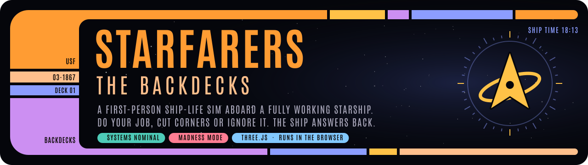
</p>

<p align="center">
  <a href="https://joshfryart.github.io/Federation-Backrooms/"></a>
</p>

<p align="center">
  <b><a href="https://joshfryart.github.io/Federation-Backrooms/">Play in your browser: joshfryart.github.io/Federation-Backrooms</a></b><br>
  <sub>Free, no install. Desktop browser with a mouse and keyboard recommended. The roguelike: <a href="https://joshfryart.github.io/Federation-Backrooms/?mode=madness">add <code>?mode=madness</code></a>.</sub>
</p>

<p align="center">
  <a href="https://github.com/joshfryart/Federation-Backrooms/actions/workflows/ci.yml"></a>
</p>

You are dealt a random billet aboard a working starship of the United Starfarers' Fleet, anyone from Captain down
to Cargo Handler, and 60 to 90 named crew go about their day around you. Do that person's job properly, rush it,
fake it or skip it: the ship and the people on it notice. A parody / homage built with three.js, no build step.

<h2 align="center"></h2>

<table>
  <tr>
    <td width="50%">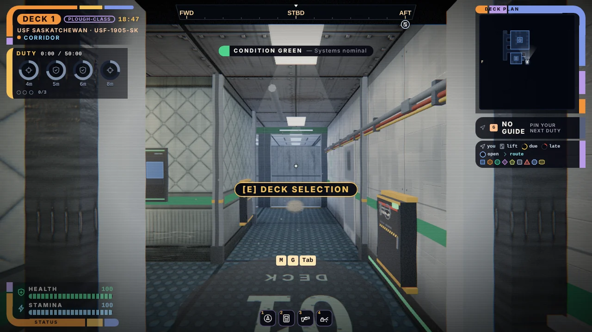<br><sub><b>On deck.</b> The HUD wears the ship's own console style.</sub></td>
    <td width="50%">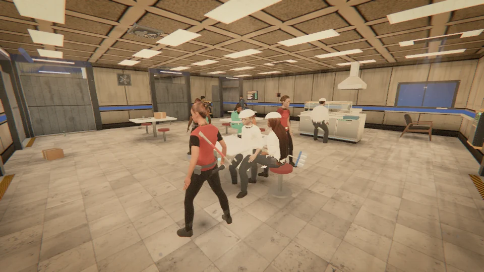<br><sub><b>The crew.</b> Everyone aboard has a name, a post and a schedule.</sub></td>
  </tr>
  <tr>
    <td>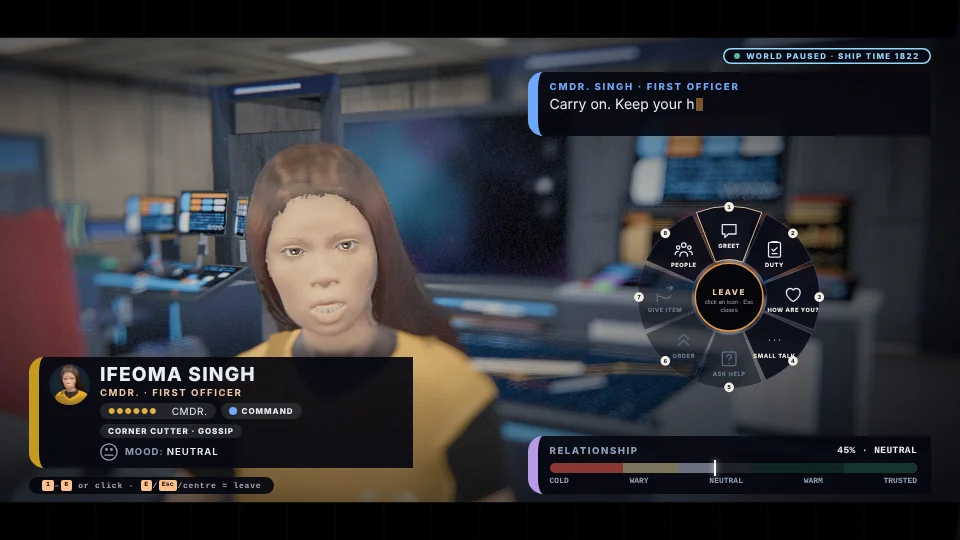<br><sub><b>Talk.</b> The camera moves in, the world pauses, trust shifts.</sub></td>
    <td>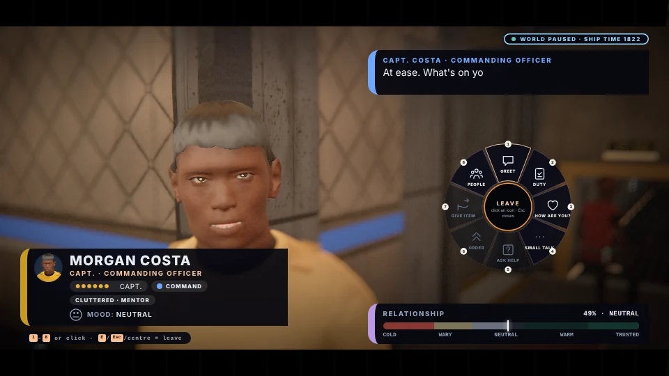<br><sub><b>Faces.</b> Distinct face shapes, skin detail, eyes and hair.</sub></td>
  </tr>
  <tr>
    <td>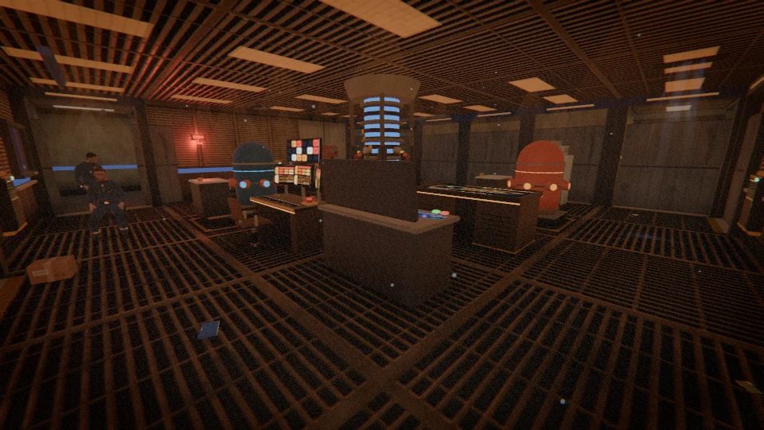<br><sub><b>Engineering.</b> Tall rooms with catwalks, lit by the baked bounce light.</sub></td>
    <td>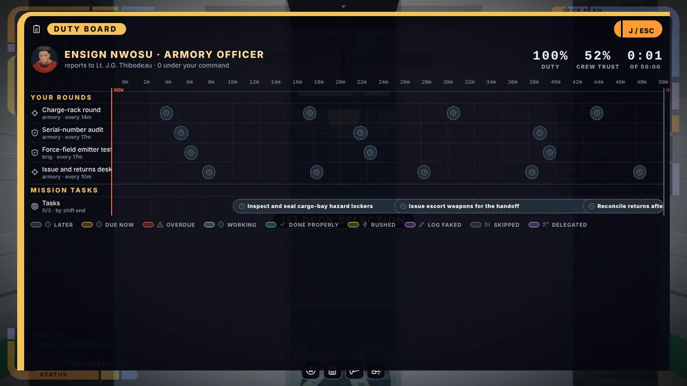<br><sub><b>Duty board (J).</b> Rounds and mission tasks across the watch.</sub></td>
  </tr>
  <tr>
    <td>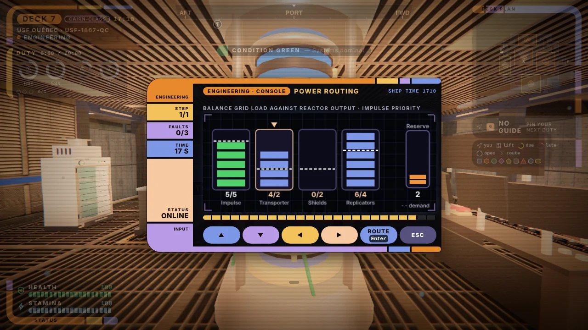<br><sub><b>Console jobs</b> play inside the LCARS frame.</sub></td>
    <td>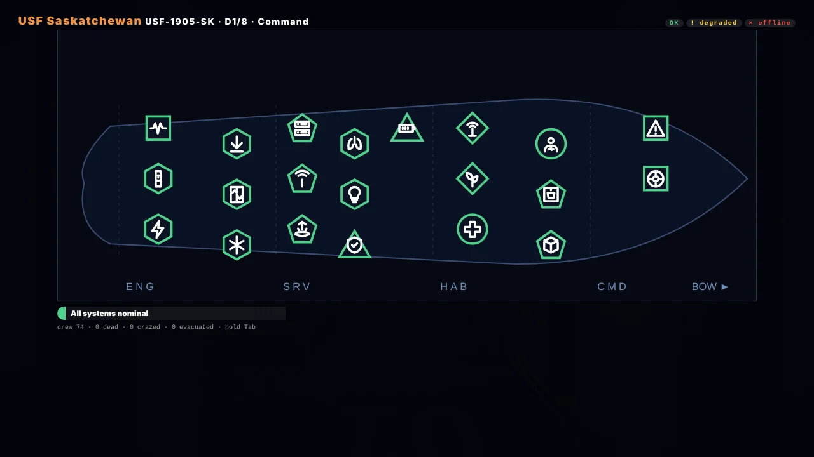<br><sub><b>Ship status (Tab).</b> Every system, every department.</sub></td>
  </tr>
</table>

<details>
<summary><b>More screenshots</b>: title, briefing, bridge, sickbay, work sites, map</summary>
<br>
<table>
  <tr>
    <td width="50%">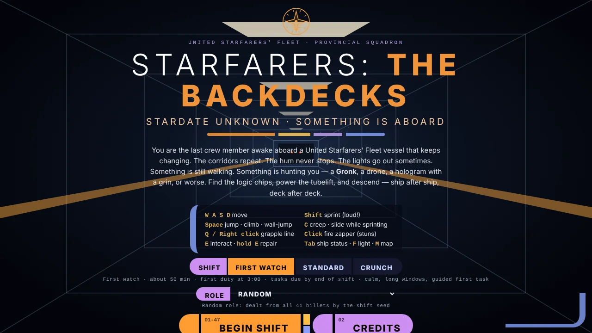<br><sub>Title: pick a shift length and a role.</sub></td>
    <td width="50%">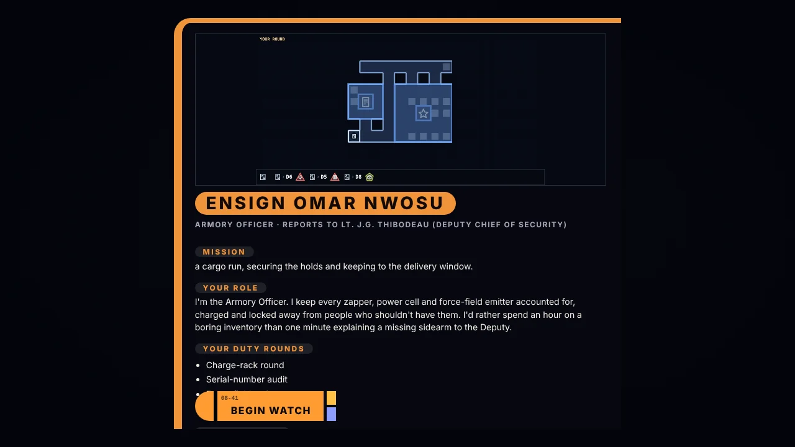<br><sub>Briefing: who you are and what is due.</sub></td>
  </tr>
  <tr>
    <td>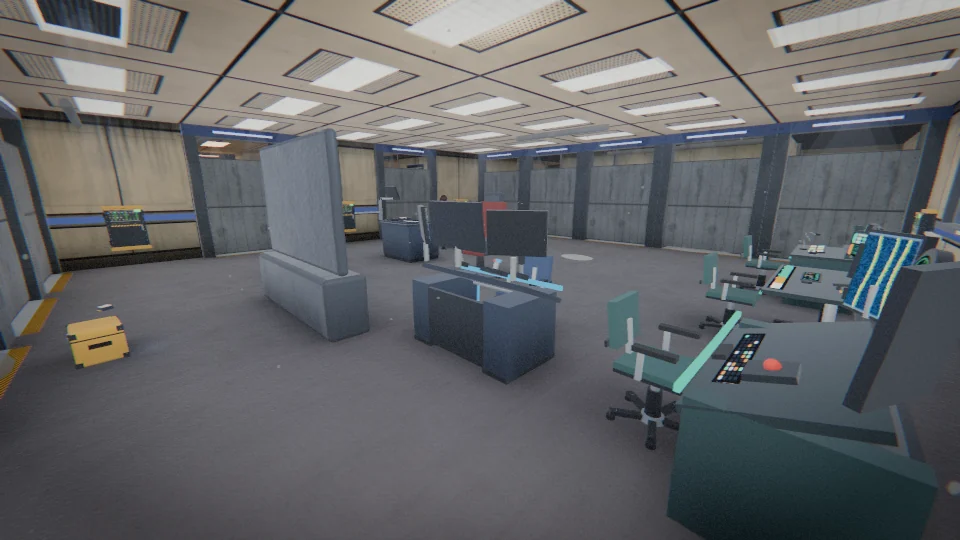<br><sub>The bridge.</sub></td>
    <td>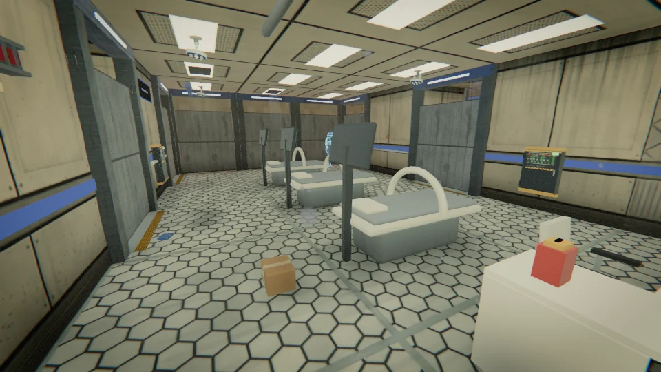<br><sub>Sickbay.</sub></td>
  </tr>
  <tr>
    <td>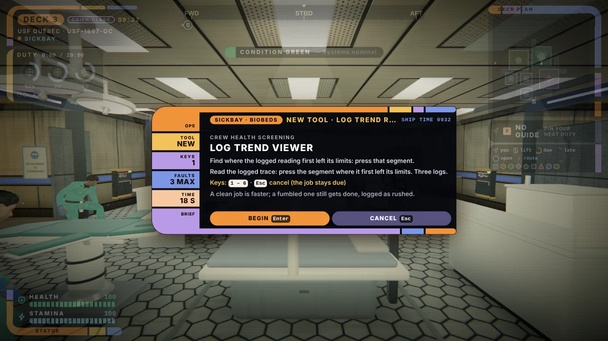<br><sub>First-use instruction card.</sub></td>
    <td>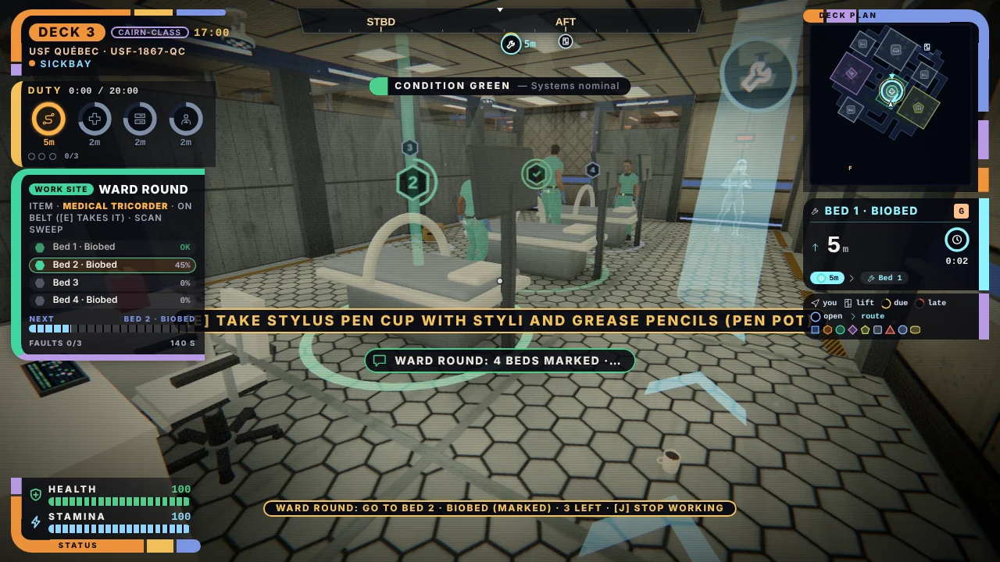<br><sub>Hands-on work sites: a ward round.</sub></td>
  </tr>
  <tr>
    <td>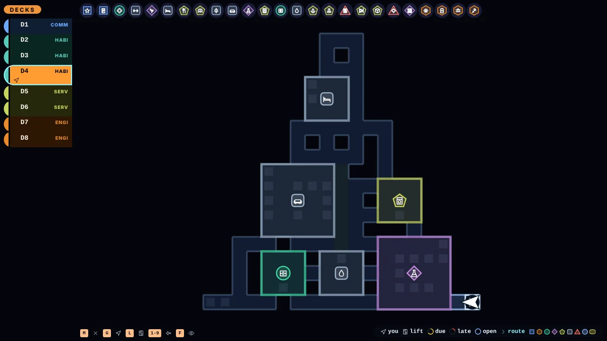<br><sub>Map (M) with every deck.</sub></td>
    <td>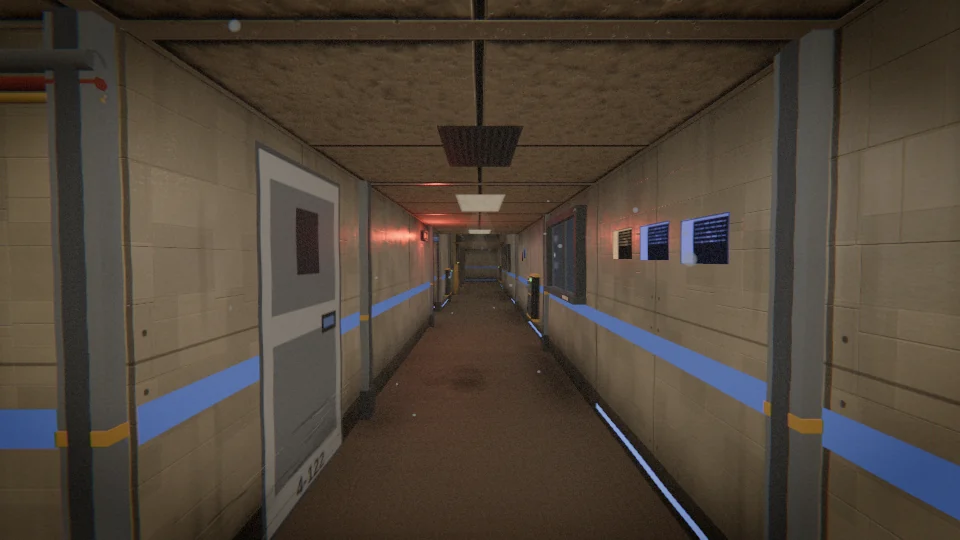<br><sub>A corridor, HUD hidden.</sub></td>
  </tr>
</table>
</details>

<h2 align="center"></h2>

At the start of a watch the game picks a ship, a mission, and one crew member to be **you**: name, rank, uniform,
superior, subordinates and duty card. The ship runs normally. Every duty you do properly, rush, fake or skip feeds a
ledger that moves system health, crew trust and what your superior thinks of you. Nothing is scripted to fail: a
ship whose duties are done stays nominal for a long time.

Ten ships (named for Canadian provinces) in five hull classes, 8 to 9 decks each, with a bridge, engineering,
sickbay, galley, cargo, arboretum and hundreds of fixtures. The crew follow schedules: they walk between stations,
ride the tubelifts, eat, work and gather in groups.

<h2 align="center"></h2>

| Mode | What it is |
|---|---|
| **Systems Nominal** (default) | The ship-life sim above, and the focus of development. Pick a shift length on the title screen: **First watch** (about 50 min, guided first task), **Standard** (about 20 min) or **Crunch** (about 14 min). |
| **Madness**<br>`?mode=madness` | The original roguelike: you are the last one awake, crew go mad one at a time from the lowest rank up, and you find logic chips, power the tubelift and descend deck after deck. Hide in racks, throw tools to pull hunters away, earn perks. |

<h2 align="center"></h2>

- **Do your job.** Duty rounds come due at stations around the ship; mission tasks must be done by the end of the
  shift. Do each one **properly** (slower, no debt) or **rushed** (faster, quietly adds duty debt). **J** opens the
  duty board: pick **Properly** and the route is pinned (minimap ribbon, floor chevrons, compass, lift panel); the
  job opens by itself when you arrive.
- **701 jobs, one mechanic each.** Every job has a small module in `js/jobs/` with its own rules, input, win
  condition and failure mode: a reactor watch where you call real temperature crossings and ignore spikes, a fuel
  hose that keeps flowing after you let go, a counsellor coaching a panicking crewman's breathing.
- **Work with your hands.** Physical jobs happen in the room with the real tool: scan patients with the medical
  tricorder, charge a hypospray inside the dose band, mop the galley, ratchet cargo straps, weld hull seams, crank
  valves, reset breakers.
- **Talk to people.** **E** on a crew member: greet, ask about duty, small talk, ask for help, give orders (rank
  permitting), swap items. Trust shifts with what you say and what you have done.
- **Keep the ship running.** Systems (reactor, life support, gravity, comms, hydroponics...) degrade and cascade into
  each other; a pacing director decides when things go wrong and when you get a breather.
- **Find your way.** Deck plan in the corner, a compass along the top, **M** for the full map, **G** to pin a
  destination with floor chevrons.
- **Fix, carry, push and fight (a little).** Hold **E** to repair. Pick up tools, trays and boxes, push carts, climb
  catwalks and service ladders. Fights are grappling and melee, not gunplay.
- **Accessibility.** The pause menu has **Calm visuals**, **Sound captions** and a **Colour-blind palette**.

<details>
<summary><b>More on the jobs</b>: console games, work sites, the audit</summary>

**Consoles.** Desk and console work plays a short mini-game about *that* job, in the ship's console style (elbow
frame, station pill and ship time, a rail of status blocks, a segmented timer). The first time you meet each tool an
instruction card in the same frame tells you how it works. Sickbay reads patient monitors, counts controlled meds
and runs counselling sessions; engineering routes power and bench-tests parts; science sweeps for a signal and
classifies contacts; security checks badges; the helm plots courses, keeps station against a current and takes star
fixes; the transporter dials drifting beam coordinates. Paperwork is themed by the job (an engineering status report
reads core temperature and EPS load; a medical one, beds and hypo stock). Reports to a person are spoken briefs:
turn to them, most urgent first, catch the wrong figure in their read-back.

**Work sites.** Every site gets a glowing ring, a beam and a numbered tag with a progress ring; the next one is
pinned, and an LCARS checklist on the left shows the sites, the item and a meter for the current action. Each job
needs the right item in your hand: if it is on your belt the first **E** takes it out, and if you do not carry one
the room's supply point is marked first.

**Rules.** Each round is seeded, and two jobs of the same kind get different content. A clean job is faster; a
fumbled one still gets done and is logged as rushed. Rushing is always one key and never a game. **Esc** (or
**J → Stop working**) cancels, and the job stays due.

**Audit.** Every job in the ship was audited twice ([docs/job-audit.md](docs/job-audit.md)):

| | before | after the audit |
|---|---|---|
| distinct activities (console games + work sites) | 38 | 101 |
| jobs done hands-on in the room | 147 | 317 of 701 |
| largest single activity | console code, 11.7 % | verbal brief, 5.6 % |
| largest share inside one department | console code, 50 % of command | verbal brief, 15 % of command |

Since then every one of the 701 jobs got its own module. [docs/procedures.md](docs/procedures.md) is the authoring
guide and `node tools/check-jobs.mjs` validates modules. None of them has been play-tested by hand yet.
</details>

<h2 align="center"></h2>

The latest passes rebuilt the look of the ship and its people, mostly by patching three.js's own materials rather
than adding render passes:

- **Lighting.** A per-deck bounce-light grid is baked on the CPU while the lift rides (one diffuse bounce of every
  panel light, plus floor-contact and wall-corner occlusion), a real HDRI, soft torch shadows and optional ambient
  occlusion (GTAO).
- **Surfaces.** Detail normals, grime, edge wear, emissive screens and dark-hull walls; a per-room colour grade and a
  single merged post pass (bloom, grade, vignette, grain, AgX tone mapping).
- **Faces.** Face-shape morphs so every crew member looks different, refined face geometry, skin detail and
  red-tinted wrap lighting, eyes with a cornea glint, lid line and gaze, and facial animation: blinks, brows,
  lip-sync visemes, mood and micro-expressions.
- **Hair and uniforms.** Strand-style hair shading with a feathered hairline, cloth weave on the uniforms.
- **Crowds.** Per-person decimated LOD meshes for bodies, hair and garments, distance culling of small face parts,
  and an **auto-quality governor** that steps render scale, shadows and effects down when frames run long.

<h2 align="center"></h2>

To be honest about it: **everything has been measured on headless Chromium with software WebGL (SwiftShader), not on a
real GPU.** On that renderer, which is far slower than any graphics card, boarding (Begin to "Enter the ship") takes
about 9 to 10 seconds and the crowd culling and LOD work cut the average scene from about 363k to 67k triangles. Real
frame times on real hardware are unmeasured.

- **Graphics** in the pause menu: *High* (bloom, shadows) or *Performance*, plus an opt-in *Ambient occlusion* box.
  On High the governor steps down by itself when frames get slow: render scale 100 % → 85 % (ambient occlusion off)
  → 70 % (smaller shadow map) → 55 % (no light cones) → Performance.
- The first load shows a loading screen and prerenders every crew portrait; press **Enter the ship** when it is ready.
- Touch controls and gamepad support exist, tested only with an emulated phone and a mocked pad.

If something runs badly on your machine, an issue with your browser, GPU and the Graphics setting is very welcome.

<h2 align="center"></h2>

**Online:** [joshfryart.github.io/Federation-Backrooms](https://joshfryart.github.io/Federation-Backrooms/)

**Locally:** the game is static files, but ES modules need http, so serve the folder:

```sh
node tools/serve.mjs 8000      # then open http://127.0.0.1:8000
python3 -m http.server 8000    # also works, but can be very slow on some machines
```

`tools/serve.mjs` is a small async static server; `http.server` answers one request at a time, and the game loads
about 260 module files.

No build step: three.js and its addons are vendored in `vendor/`; models, textures and the HDRI are in `assets/`.

<h2 align="center"></h2>

| Key | Action | | Key | Action |
|---|---|---|---|---|
| **W A S D** | move | | **J** | duty board (hold: duty wheel) |
| **Mouse** | look | | **Tab** (hold) | ship status |
| **Shift** | sprint (loud) | | **M** | map |
| **Space** | jump / climb props / wall-jump | | **G** | pin the next duty / cycle pins |
| **C** | creep, or slide while sprinting | | **Q** (hold) | quick wheel |
| **E** | interact · talk · hold to repair | | **H** | radio (hold: radio wheel) |
| **F** | flashlight | | **V** · **1–9** | tools · belt |
| **P** · **Esc** | pause · close the top menu layer | | **K** · **L** | alerts · comm log |

<h2 align="center"></h2>

`node tools/test.mjs` runs the headless suite (needs Playwright + Chromium; it starts its own static server) and
prints `OK` or `FAIL <check>` lines, each with a `replay:` command. `--gate` runs the fast node-only sections plus a
browser smoke test (under 2 minutes); `--only a,b --seed N` replays specific sections. CI runs the node sections, the
job validators and the full browser suite on every push. Details are in [TODO.md](TODO.md).

<h2 align="center"></h2>

Open these from the same server (or on the Pages site):

| Page | What it shows |
|---|---|
| `crew.html` | chain of command, department loadouts; break and repair any system and see its effects |
| `ships.html` | fleet schematics: profile and deck plans for all ten ships |
| `social.html` | the social tracker: groups, friendships, rivalries |
| `models.html` | model viewer (`?set=crew\|enemies\|misc\|props\|moves\|styles`, `?clip=<name>`) |
| `voices.html` | crew voice sampler |
| `docs/buttons.html` | the LCARS button specimen |

Design notes live in `docs/`: start with [docs/DESIGN-systems-nominal.md](docs/DESIGN-systems-nominal.md). Open work
and handoff notes are in [TODO.md](TODO.md).

<h2 align="center"></h2>

Third-party CC0 characters, animation, props, textures and HDRI, with thanks: **MakeHuman**, **dramatis3d** (Tonio
Loewald), **Quaternius**, **Poly Haven**, **ambientCG**. Code libraries: **three.js**, **meshoptimizer**, **fflate**
(MIT). Full list and licenses in [CREDITS.md](CREDITS.md).

*Starfarers: The Backdecks* is a parody / homage. It is not affiliated with, endorsed by, or connected to any
television or film franchise; all ship, species and technology names are original jokes. The README art in
`docs/readme/` is generated by `tools/build-readme-art.mjs`.

<p align="center"></p>
